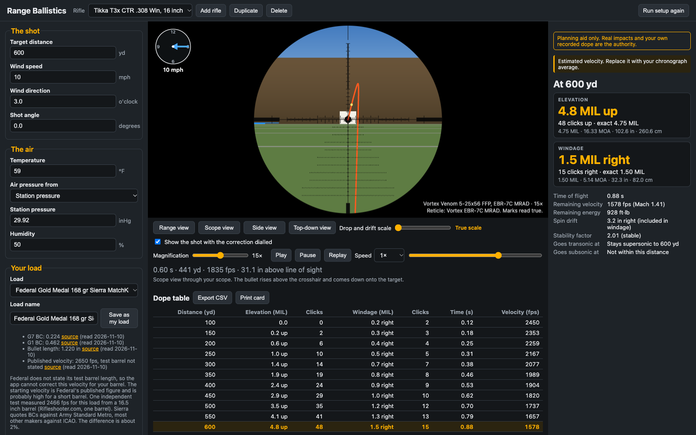
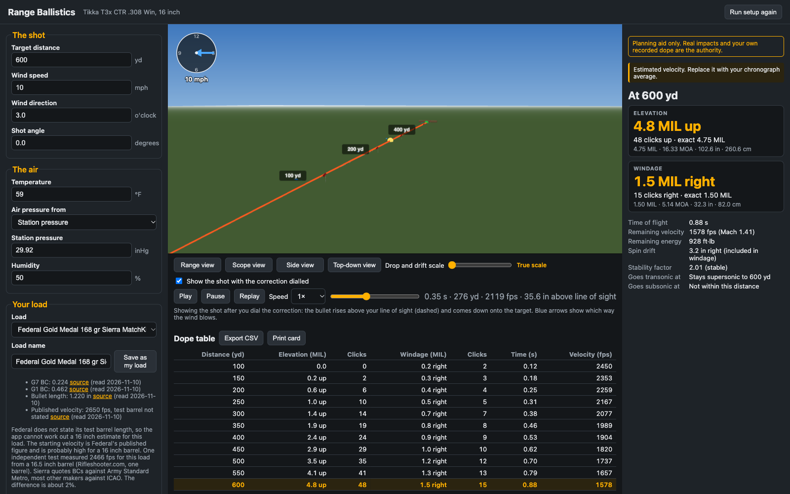
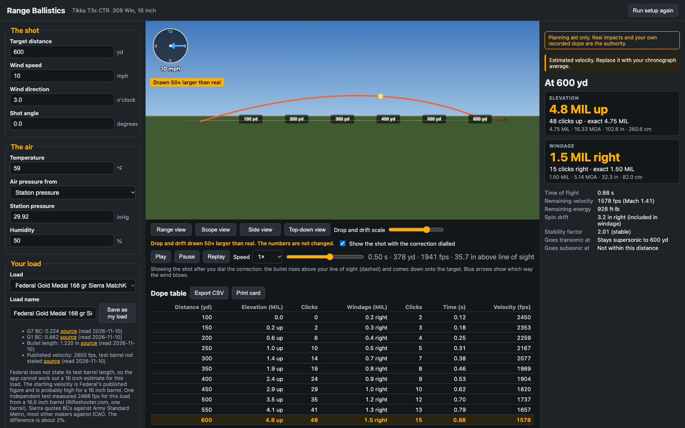
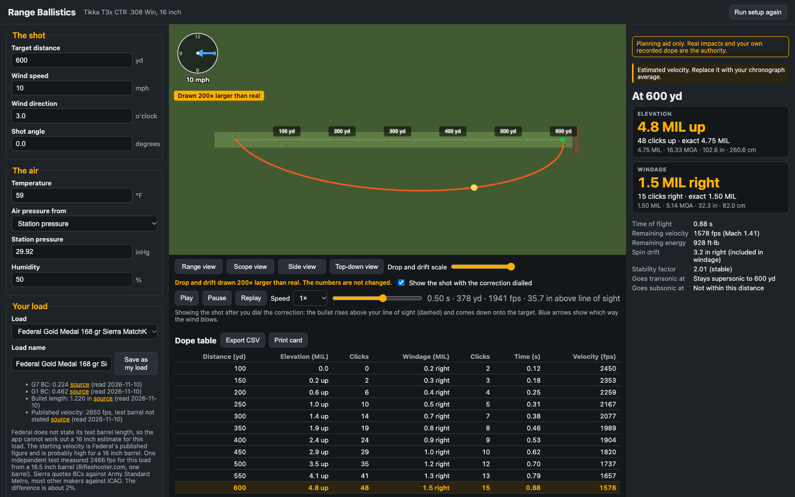
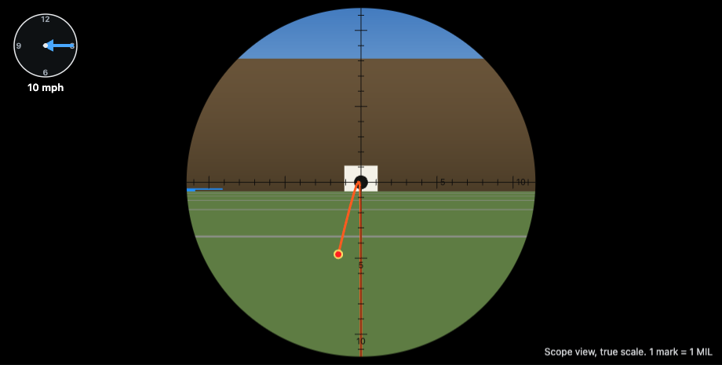
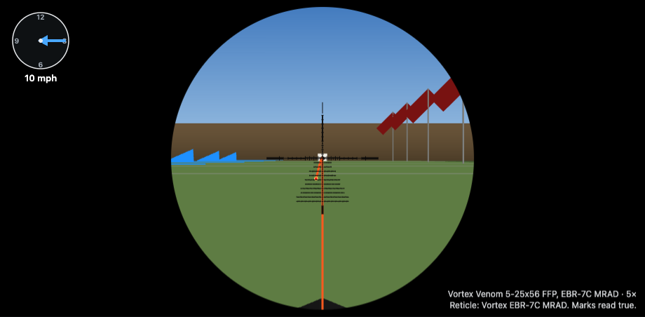
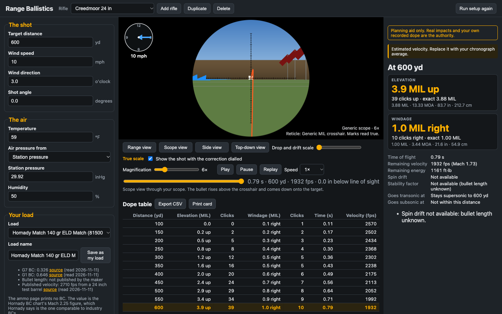
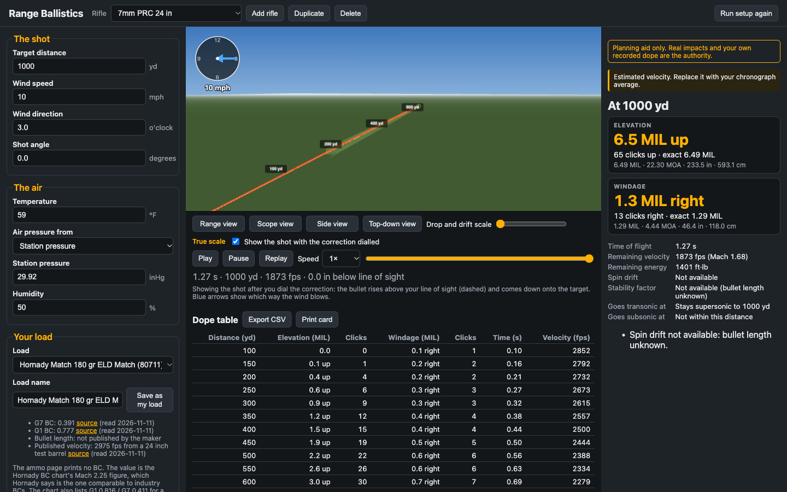
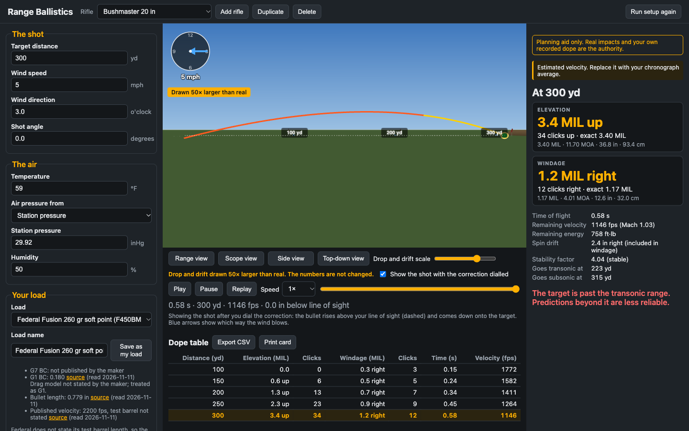

# Range Ballistics

A local web app that shows where a rifle bullet goes. You enter the distance, wind, air, and load.
It shows what to dial on the scope, a dope table, and the flight path in a 3D range.

The load library covers fifteen cartridges, from .22 Long Rifle to .300 PRC, with sourced factory
loads for each — and any other cartridge if you type your own figures. You can keep several
rifles; each one has its own cartridge, barrel, load, zero, scope, and conditions. The first rifle
starts set up as a Tikka T3x CTR in .308 Win with a 16 inch barrel and a Vortex Venom 5-25x56
scope. Every value can be changed.

**This is a planning aid.** Real impacts and your own recorded dope are the authority.



## Run it

You need Node.js 24 or newer. The repo pins it in `.node-version`, which mise, fnm, nvm and nodenv all read.

```
npm install     # once
npm start       # opens the app in your browser
```

Nothing leaves your computer. The app makes no network requests and works offline. Your rifle,
loads, and last conditions are saved in the browser's local storage.

Other commands:

| Command | What it does |
|---|---|
| `npm test` | Runs every test, including the reference comparisons |
| `npm run typecheck` | Checks the TypeScript |
| `npm run build` | Builds a static copy into `dist/` |
| `npm run preview` | Serves the built copy |

## First use

The first time, and for each rifle you add, the app walks you through five steps: confirm the
rifle, pick the scope, pick a load, set the muzzle velocity, and set your zero. You can skip it, and run it again from the top bar.

Three defaults are not measured on your rifle. The app marks each one until you replace it:

- **Muzzle velocity.** Makers measure velocity in 24 or 26 inch test barrels. A 16 inch barrel is
  slower. The app shows "estimated velocity" until you enter a chronograph average. This number
  changes the answer more than any other.
- **Barrel twist.** Tikka's own figures disagree (1:11 on the 2014 sheet, 1:10 on the current page)
  and neither lists a 16 inch barrel. The app starts at 1:11, marks it "unconfirmed", and shows how
  to measure it with a cleaning rod.
- **Sight height.** 1.75 inches is a typical figure. Measure yours from the centre of the bolt to
  the centre of the scope tube.

## Reading the screen

- **Left:** inputs. Click a field to see what it means.
- **Right:** the answer for your target distance. The large figure is what to dial, in your scope's
  unit. Under it are the clicks and the same correction in MIL, MOA, inches, and centimetres.
- **Centre:** the 3D range and the dope table.

The 3D range has four views:

| View | Shows |
|---|---|
| Range view | The whole range at true scale. Drag to orbit, scroll to zoom. |
| Scope view | The view through your scope, at true scale: its field of view at the magnification you pick, and its reticle. With the correction dialled you see the bullet rise and come down onto the target. With it off, the red dot shows where the bullet would land, so you can read the hold off the reticle. |
| Side view | The arc of the shot. Drop is drawn larger than real so you can see it. The factor is shown on screen. |
| Top-down view | The wind curve. Drift is drawn larger than real. The factor is shown on screen. |

Scaling the drawing never changes the numbers.

The same shot (600 yd, 10 mph from 3 o'clock) in the other views:

| | |
|---|---|
|  |  |
|  |  |

In the last picture the scope is at 25x and still at its zero. The red dot is where the bullet
would land: just above the 5 MRAD row and 1.5 MRAD left on the EBR-7C, the same figures the results
panel gives (4.75 up, 1.5 right).

## Your scope

Each rifle has a scope. Pick one from the list, or choose "generic scope" and type your own figures.

The list ships with the Vortex Venom 5-25x56 FFP with the EBR-7C MRAD reticle. Its magnification
range, field of view, click value, and travel are Vortex's published figures, each with a link.

- **Field of view.** The scope view covers 21.2 ft at 100 yd on 5x and 4.7 ft on 25x, as published.
- **Reticle.** The line, dot, and hash sizes are Vortex's published subtensions. The positions of
  the hashes and wind dots are drawn from Vortex's subtension diagram, which Vortex marks "for
  representation only". The app says so next to the scope.
- **First focal plane.** The reticle grows and shrinks with the target, so the marks read true at
  every magnification. A second-focal-plane scope keeps the reticle one size and the app says at
  which magnification the marks are true.
- **Dial limit.** The app warns when a correction is more than the turret can dial up from your
  zero, and shows how much is left to hold. The Venom is set to 19 MRAD (RevStop zero ring fitted).
  Change it under "Elevation you can dial" to match your mount.



## Cartridges and loads

| Cartridge | Library loads | Barrel-length velocity correction |
|---|---|---|
| .308 Winchester | 10 | 20.9 fps per inch, from one cut-down test (not manufacturer data) |
| .223 Remington | 11 | None. Published figures disagree (22 to 45 fps per inch). |
| 5.56x45 NATO | 8 | None, for the same reason. |
| .22 Long Rifle | 15 | None. The one test found shows velocity flat from about 12 to 18 inches. |
| 6.5 Creedmoor | 3 | None sourced. |
| 6.5 PRC | 3 | None sourced. |
| .243 Winchester | 3 | None sourced. |
| 7mm-08 Remington | 3 | None sourced. |
| 7mm Remington Magnum | 3 | None sourced. |
| 7mm PRC | 3 | None sourced. |
| .270 Winchester | 3 | None sourced. |
| .30-06 Springfield | 3 | None sourced. |
| .300 Winchester Magnum | 3 | None sourced. |
| .300 PRC | 3 | None sourced. |
| .450 Bushmaster | 3 | None sourced. Short-range cartridge: makers' own tables stop at 300 yd. |

The eleven cartridges added on 2026-11-11 are the rest of [Backfire's ammo-sales top 15](https://backfire.tv/popular-cartridges/).
Each ships three sourced factory loads to start; the first four cartridges carry more.

| | |
|---|---|
|  |  |



- Where a maker publishes the same load from two barrel lengths (PMC), the app uses the maker's
  own figure for your barrel.
- Where a maker gives a BC without naming the drag model (CCI, Federal, PMC, RWS), the app treats
  it as G1 and says so. The makers' own velocity tables support that: see "How it was checked".
- Eley publishes .22 LR BCs against the RA4 rimfire drag model. The solver includes RA4.
- Most .22 LR match ammunition is subsonic from the muzzle. The app says so and drops the
  transonic warning, which only applies to loads that start supersonic.
- **5.56 NATO ammunition is not safe in a barrel marked .223 Remington.** The app shows SAAMI's
  statement, in SAAMI's words, on both cartridges.
- Any other cartridge: add a rifle, choose "Other", and enter the bullet weight, diameter, BC, and
  velocity yourself.

## What the model includes

- Point-mass trajectory with G1, G7, or RA4 drag, solved with a fourth-order Runge-Kutta integrator at
  0.5 ms steps.
- Air density from temperature, station pressure, and humidity. Altitude can stand in for pressure
  (standard atmosphere).
- Air that thins or thickens along the flight on uphill and downhill shots.
- Wind from any clock direction, constant along the range.
- Uphill and downhill shots.
- Spin drift (Litz approximation from the Miller stability factor). It needs the bullet length.
- The distances where the bullet goes transonic (Mach 1.2) and subsonic.

## What it leaves out

- **BC change with velocity.** One BC is used for the whole flight. Hornady, for example, quotes a
  lower BC at lower speed, so real drop at long range is a little more than shown.
- **Aerodynamic jump** (the small vertical shift a crosswind causes).
- **Coriolis.** A small effect at these distances; not modelled.
- **Powder temperature.** Muzzle velocity does not change with temperature here.
- **Wind that changes along the range,** and vertical wind.
- **Anything past the transonic range** is less reliable. The app warns when the target is there.
- **A separate zero-day atmosphere.** The zero is solved in the current air.

## How it was checked

The solver is compared with two independent references every time the tests run.

1. **py-ballisticcalc 2.2.2**, a separate open-source solver.
   - .308: 19 shots (G1 and G7 loads, wind from several directions, altitude, heat, cold, humidity,
     15 to 30 degree slopes, a 200 yd zero, spin drift), each at ten distances from 100 to 1000 yd:
     190 points. Required: 0.05 MIL or 1%. Measured worst case: **0.007 MIL** elevation,
     **0.003 MIL** windage, 0.07% velocity, 0.03% time of flight. Inside 600 yd: 0.002 MIL.
   - The other fourteen cartridges: 38 more shots, 350 points, including subsonic and transonic
     rimfire loads, the RA4 drag model, spin drift, altitude, and the .450 Bushmaster's transonic
     300 yd flight. All pass the same tolerance.
2. **Makers' published velocity tables.** With the maker's muzzle velocity and BC, the solver
   reproduces the maker's own downrange velocities:
   - Federal Gold Medal .308, 168 and 175 gr: within 13 fps (0.75%) at 500 yd.
   - CCI and Federal .22 LR (four loads): within 0.5% out to 150 yd. Federal's published drop for
     its 1080 fps load (-7.3 in at 100 yd, -24.5 in at 150 yd) is matched within 0.3 in.
   - Federal, Hornady, and PMC .223 and 5.56 (five loads): within 1.3% at 500 yd.
   - The eleven 2026-11-11 cartridges (one Federal or Berger table each, from 6.5 Creedmoor to
     .450 Bushmaster): within 1.5% at every distance the maker prints.

Both references use the same kind of model as this app, so this shows the maths is right. It does
not show the model matches your rifle. Only shooting does that.

One thing to know: with the G7 BC that Sierra publishes (0.224 for the 168 gr), the solver runs up
to 43 fps slower at 500 yd than Federal's table, which follows the G1 figure. The app defaults to
G7 because it tracks boat-tail bullets better at long range. If your real drop is less than the app
shows, this is one place to look.

Thirteen sanity tests also run: drop grows with distance, the path crosses the line of sight at
the zero, a head or tail wind gives no drift, a full-value crosswind gives the most, denser or
colder air gives more drop, and so on.

## Where each number comes from

Every BC, bullet length, and muzzle velocity in the load list was read from the maker's own page
(on 2026-11-10 or 2026-11-11; the app shows the date) and then fetched and checked a second time. The app shows a "source" link next
to each value. A value the maker does not publish is left empty and never guessed.
The full lists are in `research/` (one file per cartridge, and one for the scope).

- The drag tables come from the py-ballisticcalc source and are generated by script. A checksum
  test fails if a single value changes.
- The barrel-length velocity figure (20.9 fps per inch) is from one Rifleshooter.com test of one
  barrel. It is not manufacturer data and is labelled that way in the app.

## Layout

```
src/solver/    physics. Pure functions, SI units, no browser code.
src/units/     unit conversion and formatting
src/data/      drag tables, load library, scopes, rifle defaults (all generated by script)
src/planner/   inputs, results, dope table, setup, saved state
src/scene/     the three.js range and the scope reticles
tests/         unit tests and reference comparisons
scripts/       data generators and the task briefs used during the build
openspec/      the specification this was built from
```
